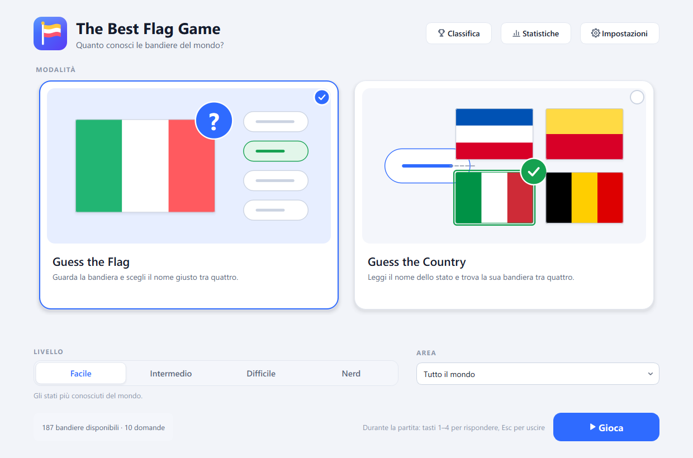
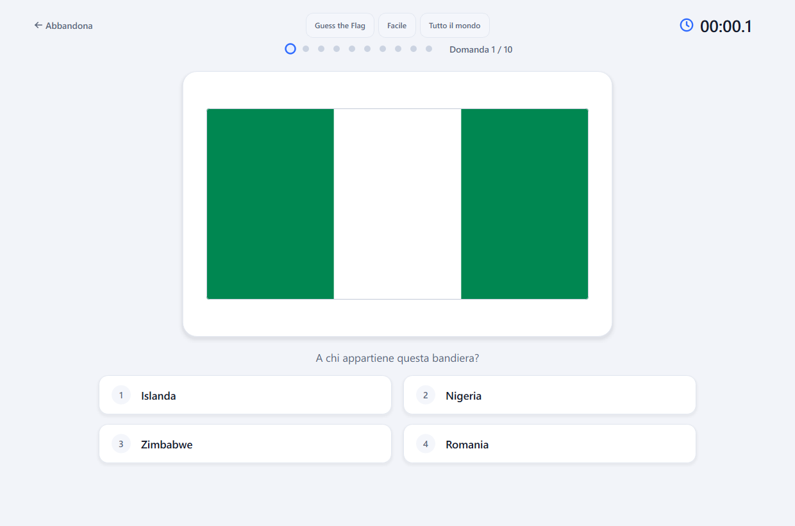
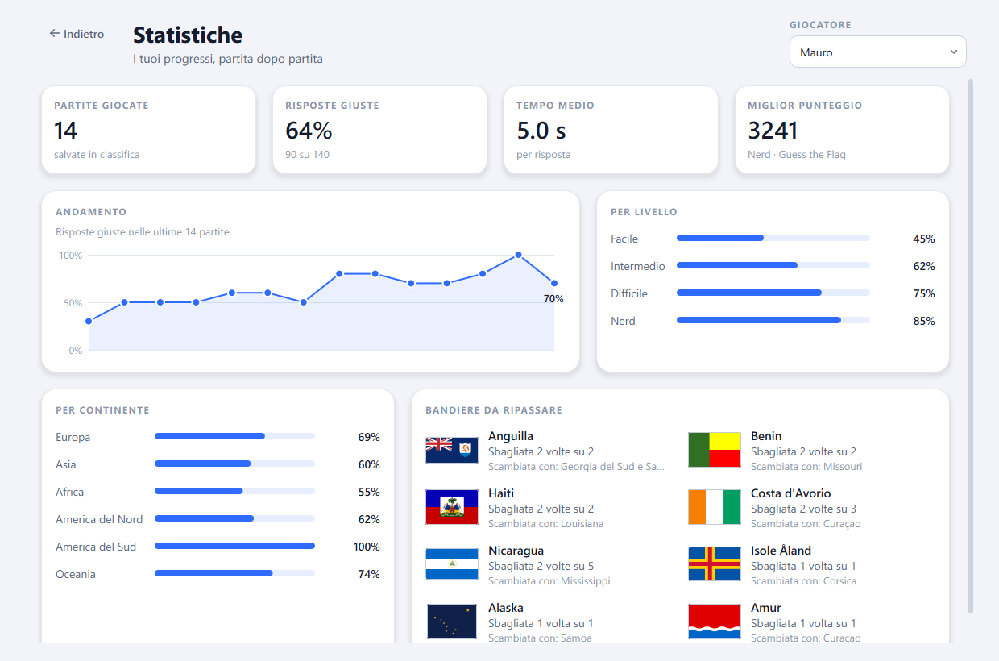

# The Best Flag Game

Gioco a quiz sulle bandiere del mondo, riscritto in Python + PySide6 (Qt 6) a partire dal
vecchio programma in Visual C#.



## Come si gioca

* **Guess the Flag**: compare una bandiera, scegli il nome giusto tra 4.
* **Guess the Country**: compare il nome di uno stato, scegli la sua bandiera tra 4.
* **Livelli**: Facile, Intermedio, Difficile, Nerd (ognuno legato alla sua cartella in `flags/`).
* **Area**: «Tutto il mondo» oppure un continente.
* 10 domande per partita, tempo misurato in mm:ss.d. Il timer si ferma durante il feedback
  dopo ogni risposta, quindi misura solo il tempo di ragionamento.
* Tasti rapidi: **1–4** per rispondere, **Invio/Spazio** (o un clic) per passare subito alla
  domanda successiva, **Esc** per abbandonare (con conferma; la partita abbandonata non va in classifica).
* Alla fine: percentuale, tempo, punti, elenco delle risposte e salvataggio in classifica con il tuo nome.
* **Statistiche** (pulsante nella home): i tuoi progressi partita dopo partita, vedi sotto.



## Avvio

### Con l'eseguibile

Apri `dist\FlagGame\FlagGame.exe`. Le bandiere **non** sono dentro l'eseguibile: il gioco usa la
cartella `flags` del progetto. La cerca accanto al programma e risalendo fino a tre cartelle
(per questo `dist\FlagGame\FlagGame.exe` trova da solo `flags`). Se sposti la cartella
`FlagGame` altrove, metti `flags` accanto a `FlagGame.exe`, oppure al primo avvio usa il
pulsante **Scegli cartella…**: la scelta viene ricordata. Si può cambiare in qualunque momento
da **Impostazioni**.

### Da Python

Serve Python 3.10 o successivo.

```bat
py -3.11 -m venv .venv
.venv\Scripts\pip install -r requirements.txt
.venv\Scripts\python main.py
```

## Creare l'eseguibile: `build.bat`

Doppio clic su `build.bat` (oppure `build.bat --senza-test` per saltare i test). Lo script:

1. cerca Python 3.12 / 3.11 / 3.13 / 3.10;
2. crea l'ambiente virtuale in `%LOCALAPPDATA%\FlagGame-build\venv` (**fuori da OneDrive**, perché
   occupa centinaia di MB che altrimenti verrebbero sincronizzati; si può cambiare con la
   variabile `FLAGGAME_BUILD`);
3. installa le dipendenze (`requirements-dev.txt`);
4. esegue tutti i test;
5. crea l'eseguibile con PyInstaller in `dist\FlagGame\`, con l'icona, e lo avvia in modalità
   di verifica (senza finestre) per controllare che parta, trovi le bandiere e apra le schermate.

**Perché `--onedir` e non `--onefile`**: con `--onefile` a ogni avvio l'eseguibile dovrebbe
scompattare circa 90 MB di librerie Qt in una cartella temporanea (avvio lento di qualche
secondo) e gli antivirus segnalano più spesso questo tipo di eseguibili. Con `--onedir`
l'avvio è immediato e la cartella `dist\FlagGame\dati` resta modificabile (nomi, continenti,
livelli) senza ricompilare.

### Avviso di Windows SmartScreen

L'eseguibile non è firmato digitalmente, quindi al primo avvio Windows può mostrare
«Windows ha protetto il PC». Clicca **Ulteriori informazioni** → **Esegui comunque**. Capita
con tutti i programmi creati in proprio con PyInstaller; se l'antivirus lo blocca, aggiungi
un'eccezione per la cartella `dist\FlagGame`.

## Dove sono salvati i dati

Tutto in `%APPDATA%\FlagGame\` (pulsante **Apri cartella** nelle Impostazioni):

| File | Contenuto |
|---|---|
| `classifica.json` | tutti i risultati salvati, con le singole risposte (da cui nascono le statistiche) |
| `storico.json` | ultime 60 risposte giuste uscite per ogni combinazione modalità/livello/area |
| `impostazioni.json` | tema, suoni, avanzamento automatico, ultimo nome, cartella delle bandiere, ultima scelta, finestra |
| `suoni\*.wav` | effetti sonori, generati al primo uso con il modulo `wave` |
| `errori.log` | eventuali errori imprevisti (il programma li mostra invece di chiudersi) |

La scrittura è **atomica**: i dati vanno prima in un file temporaneo nella stessa cartella e poi
`os.replace` lo sostituisce al file vero, così un crash a metà salvataggio non corrompe la
classifica. Un file illeggibile non viene cancellato ma rinominato in `*.danneggiato-<data>`.

## Classifica e punti

La classifica è separata per modalità, livello e area (con viste «Tutte»), mostra la top 10 e
tiene evidenziato il risultato appena salvato (anche se è fuori dalla top 10). È ordinata per
**punti** (a parità: percentuale, poi tempo):

* ogni risposta giusta vale i `"punti"` del livello in `dati\livelli.json`: **Facile 100,
  Intermedio 150, Difficile 200, Nerd 300**;
* la velocità dà un **bonus fino al 10%**: pieno con una media di 2 secondi a domanda o meno,
  nullo da 12 secondi in su, proporzionale nel mezzo.

Il bonus è volutamente piccolo: con 10 domande una risposta giusta in più vale sempre più di
qualunque bonus. Quindi, dentro la stessa combinazione, l'ordine è identico a «percentuale, poi
tempo»; nelle viste «Tutte» invece un 70% in Nerd (2100 punti) batte un 100% in Facile (al massimo
1100) e una partita breve (es. 3 domande in Nerd + America del Sud) non supera più una da 10 solo
perché ha la stessa percentuale. I punti si calcolano al momento, quindi valgono anche per i
risultati salvati prima che esistessero.

## Statistiche



La schermata **Statistiche** mostra, per il giocatore scelto (all'inizio l'ultimo nome usato):
partite giocate, percentuale di risposte giuste, tempo medio per risposta e miglior punteggio;
l'andamento delle ultime 20 partite; la percentuale per livello e per continente; le **bandiere da
ripassare**, cioè quelle sbagliate più spesso, con la risposta che hai scelto al loro posto.

Non c'è un file a parte: le statistiche si calcolano dai risultati della classifica, che da
questa versione conservano anche le singole risposte. Contano quindi solo le partite **salvate con
un nome**; i nomi si confrontano senza badare a maiuscole e spazi. I risultati salvati prima di
questa versione entrano nel riepilogo, nei livelli e nell'andamento, ma non nei continenti e nelle
bandiere da ripassare (non hanno il dettaglio delle risposte). **Cancella classifica e
statistiche** (Impostazioni) le azzera insieme.

## Aggiungere bandiere

1. Copia l'immagine (PNG, JPG, GIF, BMP, WEBP o SVG) nella cartella del livello, ad esempio
   `flags\easy\`. Per Difficile e Nerd mettila nella sottocartella del **gruppo di similarità**
   giusto (o creane una nuova, con almeno 4 bandiere). La stessa bandiera può stare in più
   livelli e in più gruppi.
2. Facoltativo, ma consigliato: aggiungi il nome italiano in `dati\nomi.json` (in
   `dist\FlagGame\dati\` per l'eseguibile). La chiave è il nome del file in minuscolo senza
   estensione (per il file `flags\intermediate\easter island.png`):

   ```json
   "easter island": {"nome": "Isola di Pasqua", "iso": null, "tipo": "territorio"}
   ```

   Senza questa voce il gioco usa il nome del file con le iniziali maiuscole.
3. Continente: aggiungilo in `dati\continenti.json` (`"mappa"`), oppure metti una copia
   dell'immagine nella sottocartella giusta di `flags\theworld\`. Con `null` la bandiera è
   esclusa dal filtro per area ma resta giocabile in «Tutto il mondo».

All'avvio il gioco controlla le immagini: i file vuoti o danneggiati vengono sostituiti con la
stessa bandiera presa da un'altra cartella, se c'è. Il numero di avvisi compare in Impostazioni.
I dettagli sui file attuali sono in [STRUTTURA_DATI.md](STRUTTURA_DATI.md).

## Aggiungere un livello

1. Crea la cartella in `flags\` (con le bandiere sciolte, oppure con sottocartelle = gruppi di similarità).
2. Aggiungi una voce in `dati\livelli.json`:

   ```json
   {"id": "esperto", "nome": "Esperto", "cartella": "expert", "distrattori": "gruppo", "punti": 400}
   ```

   `"punti"` sono i punti in classifica per ogni risposta giusta (se manca, 100).

3. Facoltativo: nome e descrizione tradotti in `flaggame\testi.py` (`LIVELLI`, `DESCRIZIONE_LIVELLI`).

## Come funzionano le domande

* **Casualità**: `random.SystemRandom` (entropia del sistema operativo): ogni avvio produce
  partite diverse.
* **Nessuna ripetizione** nella stessa partita: le risposte giuste sono tutte diverse e le 4
  opzioni di una domanda sono diverse (anche nel nome visualizzato). L'ordine delle opzioni è casuale.
* **Anti-ripetizione tra partite**: per ogni combinazione modalità/livello/area il gioco
  ricorda le ultime 60 risposte giuste uscite e sceglie tra le bandiere che non sono uscite di
  recente. Se non bastano (es. Facile + America del Sud, 12 bandiere), prende quelle uscite
  meno di recente, così le bandiere ruotano.
* **Combinazioni piccole**: il numero di domande possibili è calcolato in anticipo; il menu
  avvisa «Solo 8 bandiere disponibili: la partita avrà 8 domande» (Facile + Oceania) o
  «Solo 3…» (Nerd + America del Sud). Una combinazione senza bandiere non si può avviare.

### Gruppi di similarità e opzioni sbagliate

Nelle cartelle `difficult` e `nerd` ogni sottocartella è un gruppo di bandiere che si
somigliano (es. Nerd `18`: Andorra, Ciad, Moldavia, Romania). Le opzioni sbagliate vengono
pescate a caso per **fasce di priorità**, passando alla fascia successiva solo se la precedente
non basta:

| | Facile, Intermedio, Difficile (`"distrattori": "area"`) | Nerd (`"distrattori": "gruppo"`) |
|---|---|---|
| 1 | stesso gruppo e stessa area *(solo Difficile)* | stesso gruppo e stessa area |
| 2 | gruppi vicini e stessa area *(solo Difficile)* | stesso gruppo, qualsiasi area |
| 3 | stesso livello e stessa area | gruppi vicini e stessa area |
| 4 | altri livelli, stessa area | gruppi vicini |
| 5 | poi gruppo, livello e il resto | poi livello, area e il resto |

I **gruppi vicini** sono quelli che condividono almeno una bandiera con il gruppo della risposta
(es. Nerd `0`, `1`, `6`, `7` hanno in comune Guinea-Bissau). Così in Nerd le 4 opzioni vengono
sempre dallo stesso gruppo (tutti i gruppi hanno almeno 4 bandiere) e in Guess the Country Nerd
le 4 bandiere mostrate si somigliano davvero. Il livello Difficile usa anche lui i suoi gruppi
(la cartella `difficult` è organizzata così), ma con un filtro continente dà la precedenza al
continente, come gli altri livelli.

## Interfaccia

* Tema chiaro e scuro (Impostazioni), font Segoe UI, angoli arrotondati, ombre leggere,
  animazioni di hover e dissolvenza tra le schermate.
* Le bandiere sono mostrate **sempre con le proporzioni originali**, centrate in un riquadro
  fisso con un bordo grigio sottile (utile per le bandiere con parti bianche). I bordi
  trasparenti delle immagini vengono tolti; il Nepal, che nel file è disegnato su una tela bianca,
  viene ritagliato (`"ritaglia_sfondo": true` in `nomi.json`) e appare con la sua forma vera.
* Finestra ridimensionabile (minimo 1000×700); posizione e dimensione vengono ricordate.
* Suoni facoltativi per risposta giusta, sbagliata e fine partita.
* **Traduzione**: tutti i testi sono in `flaggame\testi.py`.

## Struttura del codice

```
main.py                     avvio (python main.py, oppure --verifica)
flaggame/
  dati.py                   scansione cartelle, nomi, continenti, gruppi (nessun file modificato)
  generatore.py             creazione delle domande e delle opzioni
  partita.py                stato della partita e cronometro con pausa
  classifica.py             classifica, punti e ordinamento
  statistiche.py            statistiche personali calcolate dalla classifica
  persistenza.py            JSON atomico, impostazioni, storico anti-ripetizione
  suoni.py                  effetti sonori generati con wave
  percorsi.py               cartelle del programma e dei dati utente
  testi.py                  tutti i testi dell'interfaccia
  ui/                       interfaccia Qt, una classe per schermata
    finestra.py             finestra principale e navigazione
    schermata_home.py, schermata_gioco.py, schermata_riepilogo.py,
    schermata_classifica.py, schermata_statistiche.py, schermata_impostazioni.py,
    schermata_cartella.py
    componenti.py           widget disegnati a mano (card, bandiere, segmenti, interruttori…)
    grafica.py              logo, icone e illustrazioni vettoriali
    tema.py                 palette chiara/scura e foglio di stile QSS
    immagini.py             caricamento e cache delle bandiere (anche SVG)
dati/                       livelli.json, nomi.json, continenti.json
assets/                     icona dell'applicazione
tests/                      test pytest
tools/genera_icona.py       rigenera assets/icona.ico dal logo
```

La logica (`dati`, `generatore`, `partita`, `classifica`, `statistiche`, `persistenza`, `suoni`)
non importa nulla di Qt: un test lo verifica.

## Test

```bat
%LOCALAPPDATA%\FlagGame-build\venv\Scripts\python -m pytest
```

Controllano tra l'altro: 1000 partite simulate per ognuna delle 56 combinazioni modalità × livello
× area (numero di domande, nessuna risposta ripetuta, nessuna opzione duplicata, risposta giusta
sempre tra le opzioni); distrattori Nerd dallo stesso gruppo (100% quando il gruppo ha almeno 4
bandiere); partite consecutive diverse; effetto dello storico; ordinamento, salvataggio,
ricaricamento e scrittura atomica della classifica; punti (una risposta giusta in più batte
sempre il bonus velocità, stesso ordine di prima dentro una combinazione, lettura dei risultati
vecchi); statistiche per giocatore, livello, continente e bandiere da ripassare; che la scansione non modifichi i file delle
bandiere; l'apertura di tutte le schermate in tema chiaro e scuro e alla dimensione minima,
giocando partite vere con tastiera e mouse. Con la variabile `FLAGGAME_SCREENSHOT=<cartella>`
i test dell'interfaccia salvano uno screenshot di ogni schermata. I test non toccano i dati in
`%APPDATA%`.
